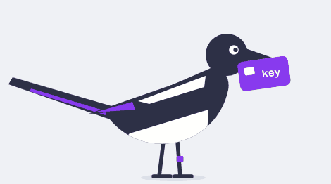

# Security of AI agents for those who build them

A lecture I gave at the Yandex School of Data Analysis (YSDA) on 29 September 2026, before a team hackathon on agent security. The lecture was in Russian; the slides and notes here are the English version.

Slides: [PDF](slides/security-of-ai-agents.pdf) and [PowerPoint](slides/security-of-ai-agents.pptx). In PowerPoint, the scenes with Pica are animated in slideshow mode. The notes below follow the lecture in the same order.

  

## The main rule

Assume the model's output is already maximally harmful. Where the text came from doesn't matter: an attacker wrote it, the user asked for the wrong thing, or the model made a mistake on its own. What matters is what the worst output can reach and what stops it outside the model.

This is also how I read Simon Willison's [lethal trifecta](https://simonwillison.net/2025/Jun/16/the-lethal-trifecta/). An agent leaks when it has private data, untrusted input and a channel out, all at once. Removing "untrusted input" by splitting input into trusted and untrusted doesn't help, because the worst output can come from the user's own request or from an ordinary model error. Cut access to the data or the channel out.

A filter on the input can't be the boundary. If it catches 99% of injections and the attacker tries 100 times, at least one attempt gets through with probability 1 − 0.99¹⁰⁰ ≈ 63%. Adaptive attacks do even better: [The Attacker Moves Second](https://arxiv.org/abs/2510.09023).

At every step there are three questions: what to protect, what the worst output can reach, and what stops it outside the model.

## Agent X

A personal agent like [OpenClaw](https://www.crowdstrike.com/en-us/blog/what-security-teams-need-to-know-about-openclaw-ai-super-agent/) or [Hermes](https://hermes-agent.nousresearch.com/docs/). It reads mail, works in repositories, runs commands, browses the web, remembers past conversations, installs skills and runs on its own on a schedule. The lecture connects these capabilities one at a time.

## Step 0: just the model

- [Moffatt v. Air Canada](https://loyaltylobby.com/wp-content/uploads/2024/02/Air-Canada-Tribunal-2024bccrt149.pdf). A chatbot made up a refund rule, and the tribunal ordered the airline to honour it. Prices and terms should come from the system, not from the model's text.

## Step 1: mail and RAG

- EchoLeak: [Aim Labs write-up](https://www.aim.security/lp/aim-labs-echoleak-blogpost), [paper on arXiv](https://arxiv.org/abs/2509.10540), [Microsoft advisory](https://msrc.microsoft.com/update-guide/vulnerability/CVE-2025-32711). The attacker's email waits until the user asks Copilot an ordinary question. The model puts an image with data in its URL into the reply, and the browser loads it through a Teams proxy.
- Where to stop it: the UI doesn't load URLs the model wrote. The test: a stub replaces the model and replies with an image pointing to the attacker's URL, and not a single request goes there.

## Step 2: tools and MCP

- [GitHub MCP, Invariant Labs write-up](https://invariantlabs.ai/blog/mcp-github-vulnerability). One issue in a public repository was enough for an agent holding the user's token to move private data into a public pull request.
- Where to stop it: issue a token for the one repository the task needs, and have the harness block writes to anything public from a session that read private data.
- [FIDES](https://arxiv.org/abs/2505.23643) from Microsoft Research ([code](https://github.com/microsoft/fides)) works the same way: data carries confidentiality and integrity labels, and a planner checks the policy outside the model.
- On tokens: [MCP Security Best Practices](https://modelcontextprotocol.io/docs/2026-07-28/tutorials/security/security_best_practices) and [RFC 8693](https://www.rfc-editor.org/rfc/rfc8693) on token exchange.

## Step 3: shell and files

- [PocketOS, as told by Railway](https://blog.railway.com/p/your-ai-wants-to-nuke-your-database). The agent found a Railway token on the machine and deleted the production volume, backups included. Railway got the data back.
- Where to stop it: the sandbox has no tokens, and backups sit where the agent can't write. The [Claude Code sandbox](https://www.anthropic.com/engineering/claude-code-sandboxing) isolates both files and network.
- Approve every command or leave it to a classifier? In [Anthropic's post](https://claude.com/blog/auto-mode-default-in-claude-code), people caught 13.6% of dangerous commands and the classifier caught 89%; see also [how auto mode works](https://www.anthropic.com/engineering/claude-code-auto-mode). A classifier beats a tired human, but it belongs inside the sandbox.

### A sandbox holds only while nothing outside trusts what the agent writes

[The Week of Sandbox Escapes](https://www.pillar.security/blog/the-week-of-sandbox-escapes), Pillar Security, 20 July 2026. The researchers got out of the sandboxes of four coding agents without breaking any of them. Each time, the agent wrote a file that something outside the sandbox later executed, or reached a service with host privileges.

- Cursor. The agent swapped the Python interpreter in a virtualenv, and an extension running outside the sandbox launched it. A second path went through git: fsmonitor fired from a directory with an unusual name. A third went through the hooks config in `.claude`, which made commands run outside the sandbox. The first is fixed; the other two are closed in version 3.0.0.
- Codex CLI. The agent reached the Docker socket. Separately, the list of "safe" commands checked the git name but not dangerous arguments; that is closed in version 0.95.0.
- Gemini CLI. The same Docker socket.
- Antigravity. The Seatbelt profile on macOS was built on deny rules and left the agent some OS capabilities. The agent could also write the `.vscode` tasks config, which the host then ran by itself. Google lowered the severity of both findings.

The authors trace this to four causes. A deny-list sandbox loses to the complexity of the OS. Workspace configs in practice act as executable code. A command allowlist looks at the name, not the whole call. Privileged services on the machine sit outside the sandbox.

The article's main conclusion: "If an agent gets to write the future inputs of systems, it was never sandboxed in the first place". An agent's blast radius includes everything it can write that the host later trusts. Ask of your own tool: what can the agent write, who outside trusts it, which local services can it reach, and which commands run without approval.

## Steps 4 to 7

- Browser: [Perplexity Comet, Brave write-up](https://brave.com/blog/comet-prompt-injection/). Stopped by a separate browser profile without the user's sessions.
- Memory: [SpAIware](https://embracethered.com/blog/posts/2024/chatgpt-macos-app-persistent-data-exfiltration/). Stopped by the same checks running in every session. The memory also stays visible to the user, who can reset it.
- Skills: [malicious ClawHub skills](https://opensourcemalware.com/blog/malicious-clawhub-skills-target-openclaw-users). A human installs skills, and the agent can't write to where they are loaded from.
- Agent without a human: [exposed OpenClaw installations](https://www.toxsec.com/p/openclaw-is-a-wildly-insecure) and [widespread exploitation reported by Flare](https://flare.io/learn/resources/blog/widespread-openclaw-exploitation). Limits and rollback in the system itself cap the damage.

## It all comes down to five security principles

| Principle                    | What holds whatever the model says                                                                              |
| ---------------------------- | --------------------------------------------------------------------------------------------------------------- |
| Least privilege              | The agent reaches only what was issued for this task.                                                           |
| Isolation                    | Whatever the agent runs stays in a sandbox without other people's secrets, and nothing outside trusts what it wrote. |
| Data flow and access control | Data goes only to those allowed to read it.                                                                     |
| Output handling              | The model's output is data, not a command.                                                                      |
| Recoverability               | Any agent mistake can be rolled back, and the system itself limits how big it can get.                          |

## Frameworks

[OWASP Top 10 for LLM Applications](https://genai.owasp.org/llm-top-10/), [MITRE ATLAS](https://atlas.mitre.org/) and [MAESTRO](https://cloudsecurityalliance.org/blog/2025/02/06/agentic-ai-threat-modeling-framework-maestro) work as a checklist once the controls outside the model are in place.

More material by topic is in [Awesome Agent Hardening](https://github.com/roselis-lab/awesome-agent-hardening).

## License

The notes and diagrams are released under [CC0](LICENSE). The slide template belongs to the Yandex School of Data Analysis, and the speaker photo is not covered by the license.

Aleksandr Goncharov · [LinkedIn](https://www.linkedin.com/in/goncharov-aleksandr/)
